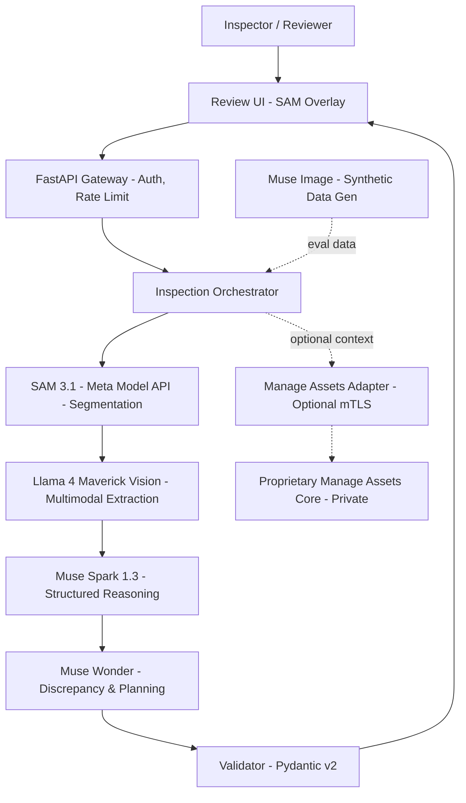

# Architecture — Asset Intelligence (Winner Edition)

- **Status:** Production-Ready Prototype for Meta Global AI Hackathon
- **Track:** Startup / Push the Frontier
- **Version:** 1.0
- **Date:** 2026-10-26
- **Mandate:** Meta-Only Stack — Zero OpenAI Dependency

## 1. Purpose & Hackathon Fit

Asset Intelligence transforms physical infrastructure inspection evidence (photos + notes) into structured, auditable intelligence using an orchestrated Meta supermodel pipeline.

**Judging:** impact 30%, creative use of Meta's tools 25%, demo+video 25%, technical depth 20%. Startup track judged on technical execution and whether it holds up in production.

**Theme:** Push the Frontier — "Give a machine a new capability... unlock a better way to understand and control a physical system". We give vision models physical defect understanding + evidence-grounded reasoning.

## 2. Principles

- **Meta-First:** Every inference via Meta Model API — Muse Spark series, Muse Wonder, Muse Image, SAM 3.1 + Llama 4 open-weights (Scout/Maverick) via Baseten/Modal partners.
- **Production-First:** Stateless, 12-factor, observable, secure by default — what Startup track demands.
- **Verifiable:** SAM masks + evidence pointers + uncertainty > pure captioning.
- **Fail-Closed:** Invalid JSON, low SAM confidence, missing evidence → error, not hallucination.
- **Human Gate:** No autonomous work order. human_review_required=true enforced in validator.
- **Private Core Boundary:** Manage Assets proprietary — only via explicit mTLS adapter, optional, not required for demo.

## 3. System Context



**Trust Boundaries:**

- Public Repo: OSS code, schemas, synthetic data only
- Meta Model API: receives only de-identified inspection evidence, disclosure in docs
- Private: never in public repo, adapter disabled by default

## 4. Logical Components — With Meta Model Assignments

### 4.1 Input Adapter

- Accepts: 1-5 images (JPEG/PNG/WebP, 15MB max), note (UTF-8, 10k chars), asset_meta
- Sanitizes: EXIF strip, MIME sniff, NSFW check (via Llama Guard? Future)
- Normalizes to InspectionRequest {request_id, images[], note, asset_meta, timestamp}
- Rejects oversize, unsupported types with 400

### 4.2 SAM 3.1 Segmentation Service — Creative Use #1

**Model:** sam-3.1 via Meta Model API

**Responsibility:**

- Zero-shot segmentation of defects: crack, corrosion, spall, vegetation, water intrusion
- Returns: masks (RLE), bboxes, confidence, label
- Prompting: text prompts ["crack", "corrosion", "water seepage"] + automatic mask generation

**Failure:** if confidence <0.4, flag uncertainty: high, require human

**Why SAM 3.1 wins points:** No training data needed, physical world understanding, instance-level evidence.

### 4.3 Llama 4 Maverick Vision Extractor — Creative Use #2

**Models:** llama-4-maverick-vision (primary), llama-4-scout-vision (cost-efficient fallback) via Meta Model API or Baseten/Modal open-weights endpoints

**Responsibility:**

- Fuse images + SAM masks + note + asset history (up to 1M token context Maverick, 10M Scout)
- Extract: asset_type, condition_tags, visible symptoms
- Output intermediate: VisionObservation {observations[], evidence_refs[]}

**Config:**

```text
META_API_BASE=https://api.meta.ai/v1
VISION_MODEL_ID=llama-4-maverick-17b-128e-vision
FALLBACK_VISION_MODEL_ID=llama-4-scout-17b-16e-vision
VISION_MAX_IMAGES=5
```

### 4.4 Muse Spark 1.3 Reasoning Gateway — Creative Use #3

**Model:** muse-spark-1.3 (reasoning, coding, agentic)

**Responsibility:**

- System prompt: "You are infrastructure inspection analyst. Return ONLY valid JSON per schema. Every observation must cite evidence: image index + mask_id or note span. Never invent measurements."
- JSON mode + tool calling for schema enforcement
- Handles auth, timeout (15s), bounded retry (2), rate limit parsing
- Logs: model_id, latency, token usage, cost

**Prompt Contract:**

```python
system = """Evidence before inference. Explicit uncertainty over false precision."""
user = f"""
IMAGES: {image_refs} with SAM masks {sam_results}
NOTE: {note}
ASSET_META: {asset_meta}
TASK: Produce JSON matching schema. If dimension missing, list in missing_information.
"""
```

### 4.5 Muse Wonder Planner — Creative Use #4

**Model:** muse-wonder

**Responsibility:**

- Multi-step reasoning: "Given observations + history, what contradicts? What's missing for a qualified decision? What is safest next step that is NOT a certification?"
- Detects: contradictory text vs image (note says dry, image shows seepage), missing scale, missing date/weather
- Generates: discrepancies[], missing_information[], recommended_next_step (non-certifying)

### 4.6 Muse Image Synthetic Generator — Creative Use #5

**Model:** muse-image via Meta Model API

**Responsibility:**

- Generate 50 synthetic defect images for eval: "concrete culvert with 2ft longitudinal crack, overcast, muddy"
- Used ONLY for testing, not training. Ensures no real PII needed.
- Also: counterfactual "what repaired looks like" for review UI (future)

### 4.7 Output Validator — Production Gate

**Tech:** Pydantic v2 + JSON Schema 2020-12

**Rules:**

- Required: asset_id, observations[], evidence[], human_review_required=true
- Every observation.evidence must reference valid image or mask_id
- uncertainty field required if SAM confidence <0.6
- No numeric dimensions unless evidence contains measurement reference
- Fail-closed: invalid → 422 with field-level errors, no partial acceptance

### 4.8 Evidence & Review Layer

- **API:** GET /inspections/{request_id}, POST /inspections/{id}/review {decision: accept|edit|reject, edits?}
- **UI:** React minimal + Canvas for SAM mask overlay, evidence click-to-highlight, missing info checklist
- **CLI:** asset-intel inspect --image crack.jpg --note "crack near top" → streams JSON + mask preview

### 4.9 Optional Manage Assets Adapter (Disabled by Default)

- mTLS client cert, scoped OAuth2, allowlist endpoints
- Translates public schema → private API contract (documented only when authorized)
- Data minimization: only sends approved fields after human review
- Demo runs WITHOUT this — satisfies hackathon public repo rule.

## 5. Detailed Request Flow — 8 Steps, 5 Meta Models

- **Ingress:** POST /v1/inspections → Auth (API key) → Rate limit (Redis) → InputAdapter validates → generates request_id (ULID)
- **SAM:** Images → SAM 3.1 → masks + bboxes (parallel per image, 2s p95)
- **Vision:** Images + masks + note → Llama 4 Maverick Vision → vision_observations
- **Reasoning:** vision_observations + masks → Muse Spark 1.3 → draft JSON (JSON mode)
- **Planning:** draft + vision → Muse Wonder → discrepancies + missing + next step
- **Validation:** Pydantic validator → if fail, return 422 with trace; if pass, attach cost + model_trace
- **Persistence (ephemeral for demo):** SQLite + S3-compatible (MinIO) for masks, 24h TTL, no PII logging
- **Review:** UI polls or SSE streams result, shows SAM overlay, human approves
- **Total cost tracked:** cost_cents = sam_tokens + vision_tokens + spark_tokens + wonder_tokens

## 6. Tech Stack — Meta-Native, Production-Ready

| Layer | Choice | Why |
| --- | --- | --- |
| API | FastAPI, Python 3.12, Uvicorn | Async, Pydantic v2, OpenAPI auto |
| Meta Inference | Meta Model API SDK (meta-ai-sdk) | Official, supports Spark, Wonder, SAM 3.1, Muse Image |
| Open-weights fallback | Llama 4 Scout/Maverick via Baseten ($100 credits) + Modal Endpoints ($100 credits) | Hackathon partners, production scale |
| Validation | Pydantic v2, JSON Schema | Fail-closed |
| Auth | API Key (header) + JWT for UI, Argon2 | Simple for demo, extensible |
| Storage | SQLite for demo, Postgres for prod; MinIO for masks | Zero cloud dep for local |
| Queue (future) | Modal Queues or Redis | Batch inspections |
| Observability | OpenTelemetry, Prometheus, structlog | OTEL traces per model call |
| Packaging | Docker, docker-compose, Makefile | docker compose up wins |
| CI | GitHub Actions: lint, test, eval, meta-only check | Startup track demands CI |
| Code Gen | Muse Code agent | Build faster, required by hackathon |

No OpenAI SDK: requirements.txt has meta-ai, baseten, modal, pydantic, fastapi — NOT openai.

## 7. Data Schemas

### InspectionRequest

```json
{
  "request_id": "ulid",
  "images": ["base64 or url"],
  "note": "string",
  "asset_meta": {"asset_id": "string", "asset_type": "string", "location": "optional"}
}
```

### InspectionResult (see PRD for full)

Includes: segmentations[], observations[]{text, evidence[{source, mask_id, span}], uncertainty}, discrepancies[], missing_information[], recommended_next_step, human_review_required, model_trace, cost_cents

## 8. Deployment Architecture

### Local (Default for Demo):

```text
docker compose up
- api: :8000 (FastAPI)
- ui: :3000 (Vite + React)
- otel-collector: :4317
- minio: :9000
- prometheus: :9090
```

### Production (Startup Vision):

- API on Modal (serverless GPUs for SAM + Llama 4) + Fly.io / Render for gateway
- Baseten for dedicated Llama 4 Maverick endpoint (2M TPM rate limit from partner)
- Cloudflare R2 for mask storage, Postgres managed

## 9. Security & Privacy

- **Secrets:** MODEL_API_KEY, BASETEN_KEY, MODAL_TOKEN via env, never committed. .env.example contains placeholders only.
- **Image handling:** EXIF GPS stripped, no raw images in logs, masks stored with TTL
- **Prompt injection:** note is treated as data, not instruction; system prompt immutable
- **Hosted inference disclosure:** README states inputs sent to Meta Model API
- **SBOM:** pip freeze > sbom.txt in CI

## 10. Observability & Auditability

**Per request:**

- request_id, model_ids, latency per model, token counts, cost_cents, validation_result, sam_mask_count, human_review_status
- OTEL span: sam.segment, vision.extract, spark.reason, wonder.plan, validate
- Metrics: inspection_requests_total, validation_failures_total, model_latency_histogram, cost_cents_histogram

## 11. Reliability & Failure Handling

| Failure | Behavior |
| --- | --- |
| Missing API key | 500 with "META_API_KEY not configured — see README" (no secret leak) |
| SAM 3.1 unavailable | Fallback to Llama Vision only, flag uncertainty high |
| Rate limit (429) | Exponential backoff 2x, max 2 retries, then 429 to client with Retry-After |
| Invalid JSON from Spark | Validator rejects, logs raw (truncated), returns 422, triggers retry with stricter prompt once |
| Low SAM confidence (<0.4) | Keep mask but set uncertainty 0.9, add to missing_information: "requires human measurement" |
| Image too large | 413, instruct resize |
| Private adapter down | Demo continues, logs warning — public path unaffected |

## 12. Cost Control

- Llama 4 Scout for cheap path: 10x cheaper than Maverick
- SAM masks cached by image hash (in-memory LRU)
- Eval uses synthetic images from Muse Image (no repeated real inference)
- Budget alert: if cost_cents >50 per request, log warning

## 13. Testing Strategy

**Unit (no API calls):**

- Schema validation, evidence pointer integrity, human_review flag enforcement, injection rejection

**Integration (mocked Meta API):**

- SAM response parsing, Maverick vision fusion, Spark JSON mode, Wonder discrepancy

**Live (separate job, requires META_API_KEY):**

- End-to-end with 5 synthetic cases, asserts schema_valid and evidence_coverage >0.8

**Evaluation (50 cases):**

- As defined in PRD, generates report eval/report.json with metrics table

## 14. Implementation Sequence — 10 Days

- **Day 1-2:** API Connectivity
  - Verify Meta Model API base, model IDs: sam-3.1, llama-4-maverick, muse-spark-1.3, muse-wonder, muse-image
  - Implement Meta Model Gateway with auth, timeout, retry
- **Day 3:** SAM Integration
  - SAM service, mask RLE decode, overlay generation
- **Day 4:** Vision + Reasoning
  - Llama 4 Vision extractor + Spark structured output
- **Day 5:** Wonder + Validation
  - Wonder planner, Pydantic validator, fail-closed logic
- **Day 6:** UI + Synthetic
  - Minimal UI with SAM overlay, Muse Image synthetic gen
- **Day 7:** Production Hardening
  - Auth, rate limit, OTEL, Docker, Makefile, CI, meta-only check
- **Day 8:** Eval
  - 50-case harness, report generation
- **Day 9:** Demo Video + Docs
  - Record 90s video, polish README
- **Day 10:** Submission

## 15. ADRs (Updated for Winning)

### ADR-001: Meta-Only Inference

**Decision:** Use only Meta Model API + Llama 4 open-weights via Baseten/Modal. No OpenAI, Anthropic, etc.

**Reason:** Hackathon requires Meta usage, startup track needs defensible stack, avoids competitor dependency.

**Consequence:** Must handle Meta API quirks, but gains partner credits and judging points for creative Meta use.

### ADR-002: SAM 3.1 as First-Class Evidence

**Decision:** SAM masks are mandatory evidence, not optional visualization.

**Reason:** Physical system understanding = segmentation, pushes frontier beyond captioning.

### ADR-003: 5-Model Orchestration > Single Model

**Decision:** SAM → Vision → Spark → Wonder → Image (eval)

**Reason:** Shows technical depth (20% of score) and creative use (25%). Each model does what it does best.

### ADR-004: Local-First Production

**Decision:** docker compose up works offline except Meta API calls.

**Reason:** Judges can run without cloud, but architecture scales to Modal/Baseten for prod.

### ADR-005: Fail-Closed Validation

**Decision:** Pydantic v2 validator rejects anything not fully evidenced.

**Reason:** Trust > coverage for infrastructure — critical for impact score.

**Agent Build Command:** make dev → make test → make eval → make verify-meta-only (greps for openai import) → make demo
