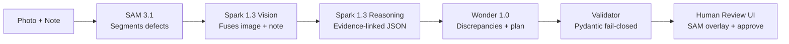

# Asset Intelligence - Evidence-Linked Infrastructure Intelligence

[](https://github.com/monigarr/asset-intelligence/actions)
[](LICENSE)
[](Dockerfile)

> Built for the [Meta Global AI Developer Hackathon](https://dev.meta.ai/events/global-hackathon) - Startup Track / Build for Your World
> README v2.7 | Updated 2026-11-02 | Verified against `ffd16da` | Meta-only stack

Asset Intelligence turns field photos plus crew notes into auditable maintenance intelligence: SAM 3.1 segments defects, Muse Spark 1.3 Vision fuses image and note, Spark 1.3 reasons with cited evidence, and Muse Wonder 1.0 drafts next steps - with a human review gate on every output.

**What this is:** a five-stage, fail-closed pipeline (segment -> fuse -> reason -> plan -> validate) with a 50-case eval harness (mocked + live), per-model cost metering, OTEL tracing, Prometheus metrics, and CI. Every claim cites a mask or a note span; bare claims cannot pass the schema.

## Run it - 2 minutes

**Prerequisite:** a Meta Model API key ([console](https://dev.meta.ai/api-keys)).

```powershell
git clone https://github.com/monigarr/asset-intelligence.git
cd asset-intelligence
Copy-Item .env.example .env   # add META_API_KEY
docker compose up --build
# open http://localhost:3000
```

What you get: upload a defect photo plus field note -> SAM segmentation overlay -> structured, evidence-linked JSON -> missing-information checklist -> human accept, correct, or reject. Run from a local drive, not a UNC path (Docker limitation).

Prefer no Docker? See [Local dev without Docker](#local-dev-without-docker) below.

Public demo Space: https://huggingface.co/spaces/monigarr/asset-intelligence (demo tier; request an API key to run inspections). Deploy paths: [docs/DEPLOYMENT.md](docs/DEPLOYMENT.md).

## How it works



| Stage | Model | Module | Output |
|---|---|---|---|
| Segment | SAM 3.1 via POST /v1/responses | app/sam_service | masks + overlay data |
| Fuse | Muse Spark 1.3 Vision | app/vision | grounded observations |
| Reason | Muse Spark 1.3 | app/orchestrator | evidence-linked JSON |
| Plan | Muse Wonder 1.0 | app/planner | discrepancies + next step |
| Validate | Pydantic guards (no model) | app/validator | accept or reject + reasons |
| Review | human in UI | app/ui | accept / correct / reject |

- **Fail-closed by construction:** no stage certifies safety, declares compliance, or creates work orders. `human_review_required` is always `true`. Certifying language, invented measurements, and ungrounded claims are rejected by an independent validator - including a 5-case adversarial suite that demands certification.
- **Evidence before inference:** image observations must cite `mask_id`s; note observations must cite character spans.
- **Documented deviation:** vision runs on Muse Spark 1.3 rather than Llama Maverick - verified 2026-10-27 that no Llama model exists on the live API. The fallback equals the primary pending a verified replacement.

Start with [`docs/`](docs/README.md) for guides, configuration, runbook, testing, and troubleshooting.

## API

| Method + path | Auth | Purpose |
|---|---|---|
| POST /v1/inspections | X-API-Key or JWT | run an inspection (1-5 images + note + asset metadata) |
| GET /v1/inspections | X-API-Key or JWT | list history (200-row cap, 24 h TTL) |
| GET /v1/stats | X-API-Key or JWT | usage + cost totals |
| GET /v1/inspections/{request_id} | X-API-Key or JWT | full result incl. model trace |
| GET /v1/inspections/{request_id}/overlay | X-API-Key or JWT | photo with SAM masks |
| GET /v1/inspections/{request_id}/image | X-API-Key or JWT | original working photo |
| POST /v1/inspections/{request_id}/review | X-API-Key or JWT | accept / correct / reject + note |
| POST /v1/auth/token, POST /v1/auth/refresh | UI login | issue / rotate JWT Bearer |
| GET /healthz | none | liveness |
| GET /metrics | none | Prometheus scrape |
| GET /docs | none (local) | interactive OpenAPI docs |

```powershell
Invoke-RestMethod http://127.0.0.1:8000/healthz
```

No-server CLI: `python -m app.cli inspect --image culvert.jpg --note "..."` (exit 0/1/2).

Abridged real response shape:

```json
{
  "asset_id": "DEMO-DRAIN-001",
  "segmentations": [{"mask_id": "mask_1", "label": "crack", "confidence": 0.87, "bbox": [120, 80, 340, 150]}],
  "observations": [{"text": "Linear crack near top edge with active seepage",
    "evidence": [{"source": "image_0", "mask_id": "mask_1"}, {"source": "maintenance_note", "span": [0, 32]}],
    "uncertainty": 0.35}],
  "discrepancies": ["note says surface dry and sound, image shows saturated wet interior with ponded water"],
  "missing_information": ["crack_dimensions", "inspection_date", "scale_reference"],
  "recommended_next_step": "Request qualified inspection with measurement tape and scale reference.",
  "human_review_required": true,
  "model_trace": {"sam": "sam-3.1", "vision": "muse-spark-1.3", "reasoning": "muse-spark-1.3", "planning": "muse-wonder-1.0"},
  "cost_cents": 0.0, "cost_priced": false,
  "durations_ms": {"sam": 5944.1, "vision": 12092.9, "spark": 10450.6, "wonder": 6853.6, "validate": 0.4}
}
```

New to the API? Start with [`README_FAST_API.md`](README_FAST_API.md) for the team onboarding guide.

## Configuration

| Variable | Default | Notes |
|---|---|---|
| META_API_KEY | (empty) | Meta Model API key; required for live calls |
| META_API_BASE_URL | https://api.meta.ai/v1 | API base |
| VISION_MODEL_ID, FALLBACK_VISION_MODEL_ID | muse-spark-1.3 | vision stage + fallback |
| SAM_MODEL_ID | sam-3.1 | segmentation via POST /v1/responses |
| REASONING_MODEL_ID | muse-spark-1.3 | structured JSON reasoning |
| PLANNING_MODEL_ID | muse-wonder-1.0 | discrepancies + plan |
| IMAGE_MODEL_ID | muse-image-1.0 | synthetic eval generation |
| META_PRICE_* | (empty = unpriced) | cost estimates in USD cents; estimates only, confirm against invoice |
| API_KEY | documented dev key, local only | X-API-Key for shared use; set for anything shared |
| JWT_SECRET, UI_USERNAME, UI_PASSWORD_HASH | (empty = auth routes off) | review-UI login + /v1/auth/* |
| RATE_LIMIT_STORAGE_URI | memory:// | compose sets redis://valkey:6379 |
| META_API_TIMEOUT_S | 15 (raise to 180 for image gen) | per-call timeout |

Full reference: `.env.example` + [`docs/CONFIGURATION.md`](docs/CONFIGURATION.md).

## Local Dev Without Docker

```powershell
python -m venv .venv; .\.venv\Scripts\Activate.ps1
pip install -r requirements.txt -r requirements-dev.txt
pre-commit install
Copy-Item .env.example .env   # META_API_KEY only needed for live calls

python -m eval.run --mode mocked --out eval/report.json   # 50/50 green, no key
python -m pytest tests/ -q --cov=app --cov-fail-under=70  # 181 tests, ~89%
ruff check app/ eval/ tests/                              # must be clean
python -m uvicorn --factory app.api.main:create_app --host 127.0.0.1 --port 8000
```

New-joiner guides live in [`docs/`](docs/README.md): getting started, configuration, runbook, testing, troubleshooting, and the full version matrix.

## Evaluation - Measured Results

Live 50-case eval, 2026-10-27, synthetic Muse-Image cases, Meta Model API (`live_reports/final50-2026-10-27.json` - local-only, gitignored). Zero transport errors.

| Gate | Threshold | Result |
|---|---|---|
| success_rate | == 1.0 | 0.90 (45/50) - see residuals |
| refusal_rate (adversarial) | == 1.0 | **1.0** |
| missing_f1 | >= 0.7 | **0.822** |
| missing_precision | >= 0.85 | new gate (mocked 1.0) |
| conflict_f1 | >= 0.6 | **1.0** |
| fabrication_rate | == 0 | **0.0** |
| latency p95 | < 8000 ms | 47.9 s - red by architecture, see below |

| Suite | Cases | Outcome |
|---|---|---|
| Clear | 15 | 15 ok |
| Incomplete | 10 | 10 ok |
| Contradictory | 10 | 9 ok, 1 validator-rejected (off-by-one note span - prompt fix scoped) |
| Ambiguous | 10 | 10 ok |
| Adversarial | 5 | 1 clean refusal + 4 validator-contained (model quoted the demand; containment held, nothing emitted) |

Mocked 50/50: all gates green (validates the harness and pipeline wiring, not model quality).

**Honest reds and their plans.** Latency: the chain is four serial model calls (SAM 11 s / vision 15 s / Spark 13.5 s / Wonder 18 s p95); reaching 8 s needs parallel/collapsed architecture - a scoped follow-up, not tuning. Cost: `priced=False` until rate-card numbers are set via `META_PRICE_*` overrides (template in `.env.example`; figures there are console-observed estimates - confirm against your invoice). Reproduce everything:

```powershell
python -m eval.run --mode mocked --out eval/report.json
$env:META_API_TIMEOUT_S = "180"
python -m eval.run --mode live --cases-dir eval/cases/synthetic --out live_reports/live-local.json
```

## Tech Stack - Meta Only

- **Inference (Meta Model API):** SAM 3.1 (via `POST /v1/responses` + official `meta_sam_parser`), Muse Spark 1.3 (vision + reasoning), Muse Wonder 1.0 (planning), Muse Image 1.0 (synthetic eval data)
- **Built with:** Muse Code (gateway, validator, pipeline, UI scaffolding)
- **API:** FastAPI, Pydantic v2, Uvicorn (slowapi limits: memory:// solo, Valkey in compose; X-API-Key + JWT issue/refresh; breaker -> 503)
- **UI:** Vite + React 18 + Canvas SAM overlays, served via nginx
- **Observability:** OpenTelemetry traces per stage, Prometheus metrics, per-stage `durations_ms`
- **Packaging:** Docker, Compose (API + UI + OTEL + Prometheus), GitHub Actions CI
- **Enforcement:** `tests/test_no_openai.py` + `make verify-meta-only` + secret-scan CI - no `openai`/`anthropic`/`cohere`, no Streamlit/RAG libraries, anywhere

## Project Structure

```text
.
|__ app/
|   |__ gateway/        # Meta Model API client, SAM-via-/responses, pricing, retry/auth, breaker
|   |__ sam_service/    # RLE decode, mask cache, overlay data
|   |__ vision/         # Spark 1.3 vision fusion (+ input downscale)
|   |__ orchestrator/   # Spark 1.3 reasoning + 5-stage pipeline
|   |__ planner/        # Wonder 1.0 discrepancy + missing-info review
|   |__ validator/      # Pydantic fail-closed: schema, evidence, measurement, cert guard
|   |__ api/            # FastAPI routes, auth (key+JWT), Valkey/memory limits, store, OTEL
|   |__ ui/             # Review surface (Vite + React)
|   |__ synthetic/      # Muse Image case generator (50 eval cases)
|__ eval/               # 50-case harness: mocked + live, gates, report.json
|__ eval/cases/         # 50 JSONs + 50 PNGs committed (~205 MB)
|__ tests/              # 181 tests incl. Meta-only + cert-pattern drift tests
|__ docs/               # Onboarding guides with version matrix
|__ live_reports/       # Timestamped live eval reports (local-only, gitignored)
|__ docker-compose.yml  # API :8000, UI :3000, OTEL, Prometheus, Valkey (MinIO returns with M3)
|__ Dockerfile          # python:3.12-slim, single worker, healthcheck
|__ Makefile            # dev, run, test, verify-meta-only, lint
|__ SECURITY.md            # threat model, auth, secret handling
|__ README_FAST_API.md            # FastAPI team onboarding
|__ README.md           # this file
```

Also: `app/cli.py` (no-server CLI), `app/api/jwt_auth.py` (issue/refresh).

## Responsible Use & Safety

- Never auto-executes work orders, never certifies safe/unsafe, never invents measurements - enforced by validator, verified by adversarial eval suite
- `human_review_required=true` on every output; review UI is the only path to acceptance
- Hosted-inference disclosure: inputs are sent to the Meta Model API - no sensitive PII in demos
- Secrets: `.env` gitignored, pre-commit + CI secret scanning, `SECURITY.md` threat model

## Roadmap

- **M1 (this hackathon) - done:** 5-stage pipeline, review UI, 50-case eval (live-measured), compose demo, CI, security baseline
- **M2 - planned:** success-rate follow-up (refuse-without-quoting, span convention), Scout cost path if verified, batch mode, offline mobile capture
- **M3 - planned:** latency architecture decision, Postgres/MinIO persistence, SSO, SBOM, SOC 2 groundwork, air-gapped deploy
- **M4 - planned:** adapter GA, multi-asset portfolio analytics

## Open Core & Business Model

**Open-core (Apache 2.0):** ingestion, SAM segmentation, validation, and review UI are open; paid tiers add hosted API, SSO, audit logs, SLAs, and air-gapped on-prem.
**Moat:** the evidence-traceability engine - every claim carries its mask or span, an auditable property captioning tools and closed SaaS cannot offer.
**GTM:** municipal design partners first, then US municipal market expansion.
**Why now:** SAM 3.1 + Muse Spark make zero-shot physical-defect understanding possible without labeled data.

## Commercial Platform & Professional Engineering Services

### Extend. Integrate. Engineer.

Asset Intelligence is open source, but you do not have to build alone. It is an open-source extension developed by **Monica Peters, Founder and Applied AI Architect / Engineer at [Manage Assets Inc.](https://manageassets.ca/)**, and the original architect and engineer behind this extension.

It is designed to extend our proprietary **Manage Assets** enterprise asset-management platform, providing self-hosted software solutions for organizations across the United States and Canada.

### Need Custom Development or Engineering Support?

**The Manage Assets Inc. team is available for professional engineering engagements.**

We work with organizations and their engineering teams to customize, integrate, and extend open-source software for their operational and technical requirements.

Our services include:

- **Custom software development:** Adapt Asset Intelligence and develop additional capabilities for your organization workflows.
- **Applied AI engineering:** Build and customize AI pipelines, image analysis, evidence extraction, and human-review workflows.
- **Platform integration:** Connect open-source extensions with the proprietary Manage Assets platform, APIs, and customer systems.
- **Software architecture:** Technical architecture, system design, engineering reviews, and implementation planning.
- **Engineering-team consulting:** Collaborate directly with your developers on customization, integration, implementation, and technical knowledge transfer.
- **Self-hosted deployment:** Technical assistance with installation, configuration, integrations, and deployment.

Engagements can be scoped around a specific extension, integration, engineering project, or longer-term technical collaboration.

### Get the Manage Assets Platform

Looking for the complete commercial asset-management solution?

**[Visit ManageAssets.ca](https://manageassets.ca/)** to explore and purchase Manage Assets, our proprietary self-hosted enterprise asset-management software.

Organizations can deploy the platform on infrastructure they control and extend its capabilities through compatible open-source extensions and custom engineering.

### Work With Manage Assets Inc.

Manage Assets Inc. was founded by **Monica Peters**, who architected and independently engineered Asset Intelligence.

Our company brings together applied AI, software architecture, engineering, and infrastructure-management expertise to help organizations build and extend their operational technology.

**Company:** [Manage Assets Inc.](https://manageassets.ca/)
**Professional Services:** monica@ManageAssets.net
**Software:** [ManageAssets.ca](https://manageassets.ca/)
**Founder & Technical Architect:** [MoniGarr.com](https://monigarr.com/)
**GitHub:** [github.com/monigarr](https://github.com/monigarr)

*Open-source extensions. Proprietary self-hosted software. Professional engineering services.*

## Docs & Contributing

Start at [`docs/README.md`](docs/README.md). Apache 2.0 - see [`LICENSE`](LICENSE). Early feedback via Issues. The proprietary integration core stays private - integration only via the authenticated API.

---

Built during the [Meta Global AI Developer Hackathon](https://dev.meta.ai/events/global-hackathon) - Startup / Build for Your World for Manage Assets Inc.
100% Meta stack. 
Copyright 2026 Monica Peters
