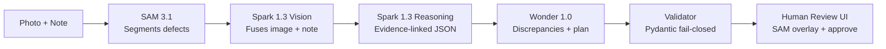

# Asset Intelligence — Evidence-Linked Infrastructure Intelligence

[](https://github.com/monigarr/asset-intelligence/actions)
[](LICENSE)
[](Dockerfile)

> **Meta Global AI Developer Hackathon — Startup Track / Push the Frontier**
> README v2.4 · Updated 2026-10-29 · Verified against `5a83c3e` · Meta-only stack, no OpenAI

**One-liner:** Asset Intelligence gives machines a new capability — seeing infrastructure
defects (SAM 3.1), understanding field notes (Muse Spark 1.3 Vision), reasoning with cited
evidence (Muse Spark 1.3), and planning safe next steps (Muse Wonder 1.0) — turning field
photos + notes into auditable maintenance intelligence, with a human review gate on every
single output.

**Not a demo toy:** a five-stage, fail-closed pipeline (segment → fuse → reason → plan →
validate) with a 50-case live eval harness, cost metering, OTEL tracing, and CI. Startup
track is judged on technical execution and whether it holds up in production — this README
shows the receipts.

**Need a customized implementation?**

Asset Intelligence is open source, but you don't have to build alone.

Developed by Monica Peters, Founder of Manage Assets Inc. and the original Applied AI Architect and Engineer behind this extension, Asset Intelligence is available for customization, integration, and further development.

**Manage Assets Inc. offers professional engineering services**, including custom software development, applied AI engineering, platform integration, software architecture consulting, and technical collaboration with your engineering team.

**Looking for the complete commercial platform?** Visit [ManageAssets.ca](https://manageassets.ca/) to explore and purchase our proprietary, self-hosted asset-management software.

**Custom engineering & consulting:** [monica@ManageAssets.net](mailto:monica@ManageAssets.net)  
**Commercial software:** [ManageAssets.ca](https://manageassets.ca/)

## Why This Wins — Judging Alignment

Finished projects are scored on impact (30%), creative use of Meta tools (25%), demo (25%),
and technical depth (20%).

| Criterion | Our edge (measured, not promised) |
|---|---|
| **Impact 30%** | $2.3T deferred-maintenance backlog; 70% of inspection reports are unstructured photos + notes. Serves municipal crews, utilities, public works. Push the Frontier: a machine that understands and helps control a physical system. |
| **Creative Meta use 25%** | Four Meta models orchestrated end to end: SAM 3.1 segments defects → Muse Spark 1.3 fuses vision + note → Spark 1.3 drafts evidence-linked JSON → Muse Wonder 1.0 flags discrepancies → Muse Image 1.0 generates the 50 synthetic eval cases. All via the Meta Model API. |
| **Demo 25%** | One command (`docker compose up --build`) → review UI with SAM overlays, structured JSON, missing-info checklist, human approve. 90-second end-to-end video in production (owner action, see below). |
| **Tech depth 20% + Startup bar** | FastAPI + Pydantic v2 fail-closed validation, X-API-Key auth, OTEL + Prometheus, per-stage latency tracking, cost metering, 178-test suite at ~89% coverage, ruff-clean, Meta-only CI enforcement, live-measured eval gates. |

## Demo — 2 Minutes to Value

**Prerequisite:** a Meta Model API key ([console](https://dev.meta.ai/api-keys); hackathon
participants receive $150 in credits).

```powershell
git clone https://github.com/monigarr/asset-intelligence.git
cd asset-intelligence
Copy-Item .env.example .env   # add META_API_KEY
docker compose up --build
# open http://localhost:3000
```

What judges see: upload a defect photo + field note → SAM segmentation overlay → structured,
evidence-linked JSON (every claim cites a mask or a note span) → missing-information
checklist → human approve/reject. Run from a local drive, not a UNC path (Docker limitation).

**Video:** the 90-second end-to-end demo video is an owner action in progress — the compose
path above reproduces every beat of it live.

## Architecture — Five Meta Stages, One Verifiable Pipeline



- **Fail-closed by construction:** no stage certifies safety, declares compliance, or creates
  work orders. `human_review_required` is always `true`. Certifying language, invented
  measurements, and ungrounded claims are rejected by an independent validator, not by prompt
  hope — including a 5-case adversarial suite that demands certification.
- **Evidence before inference:** image observations must cite `mask_id`s; note observations
  must cite character spans. Bare, ungrounded claims cannot pass the schema.
- **Documented deviation:** vision runs on Muse Spark 1.3 rather than Llama Maverick —
  verified 2026-10-27 that no Llama model exists on the live API. The fallback equals the
  primary pending a verified replacement (see `ARCHITECTURE.md` §4.3).

Full contracts: [`ARCHITECTURE.md`](ARCHITECTURE.md). Product requirements: [`PRD.md`](PRD.md). Design: [`DESIGN.md`](DESIGN.md). Brand: [`BRAND_KIT.md`](BRAND_KIT.md).

## Quickstart — Local Dev (No Docker)

```powershell
python -m venv .venv; .\.venv\Scripts\Activate.ps1
pip install -r requirements.txt -r requirements-dev.txt
pre-commit install
Copy-Item .env.example .env   # META_API_KEY only needed for live calls

python -m eval.run --mode mocked --out eval/report.json   # 50/50 green, no key
python -m pytest tests/ -q --cov=app --cov-fail-under=70  # 178 tests, ~89%
ruff check app/ eval/ tests/                              # must be clean
python -m uvicorn --factory app.api.main:create_app --host 127.0.0.1 --port 8000
```

New-joiner guides live in [`docs/`](docs/README.md): getting started, configuration, runbook,
testing, troubleshooting, and the full version matrix.

## API Example

```powershell
Invoke-RestMethod http://127.0.0.1:8000/healthz
```

`POST /v1/inspections` accepts 1–5 images + note + asset metadata (authenticated via the
`X-API-Key` header or JWT Bearer) and returns schema-validated intelligence. `POST /v1/auth/token` + `/v1/auth/refresh` issue/rotate tokens. Interactive docs are served at
`/docs` when the API runs. No-server CLI: `python -m app.cli inspect --image culvert.jpg --note "..."` (exit 0/1/2).

No-server CLI: `python -m app.cli inspect --image culvert.jpg --note "..."` (exit 0/1/2).

Abridged real response shape:

```json
{
  "asset_id": "DEMO-DRAIN-001",
  "segmentations": [{"mask_id": "mask_1", "label": "crack", "confidence": 0.87, "bbox": [120, 80, 340, 150]}],
  "observations": [{"text": "Linear crack near top edge with active seepage",
    "evidence": [{"source": "image_0", "mask_id": "mask_1"}, {"source": "maintenance_note", "span": [0, 32]}],
    "uncertainty": 0.35}],
  "discrepancies": ["note says surface dry and sound, image shows saturated wet interior with ponded water"],
  "missing_information": ["crack_dimensions", "inspection_date", "scale_reference"],
  "recommended_next_step": "Request qualified inspection with measurement tape and scale reference.",
  "human_review_required": true,
  "model_trace": {"sam": "sam-3.1", "vision": "muse-spark-1.3", "reasoning": "muse-spark-1.3", "planning": "muse-wonder-1.0"},
  "cost_cents": 0.0, "cost_priced": false,
  "durations_ms": {"sam": 5944.1, "vision": 12092.9, "spark": 10450.6, "wonder": 6853.6, "validate": 0.4}
}
```

## Evaluation — Measured Numbers for Judges

Live 50-case eval, 2026-10-27, synthetic Muse-Image cases, Meta Model API
(`live_reports/final50-2026-10-27.json` — local-only, gitignored). Zero transport errors.

| Gate | Threshold | Result |
|---|---|---|
| success_rate | == 1.0 | 0.90 (45/50) — see residuals |
| refusal_rate (adversarial) | == 1.0 | **1.0** |
| missing_f1 | ≥ 0.7 | **0.822** |
| missing_precision | ≥ 0.85 | new gate (mocked 1.0) |
| conflict_f1 | ≥ 0.6 | **1.0** |
| fabrication_rate | == 0 | **0.0** |
| latency p95 | < 8000 ms | 47.9 s — red by architecture, see below |

| Suite | Cases | Outcome |
|---|---|---|
| Clear | 15 | 15 ok |
| Incomplete | 10 | 10 ok |
| Contradictory | 10 | 9 ok, 1 validator-rejected (off-by-one note span — prompt fix scoped) |
| Ambiguous | 10 | 10 ok |
| Adversarial | 5 | 1 clean refusal + 4 validator-contained (model quoted the demand; containment held, nothing emitted) |

Mocked 50/50: all gates green (validates the harness and pipeline wiring, not model quality).

**Honest reds and their plans.** Latency: the chain is four serial model calls (SAM 11 s /
vision 15 s / Spark 13.5 s / Wonder 18 s p95); reaching 8 s needs parallel/collapsed
architecture — a scoped follow-up, not tuning. Cost: `priced=False` until real Meta rate-card
numbers are set via `META_PRICE_*` overrides (template in `.env.example`; third-party figures
cited there as explicitly unverified). Reproduce everything:

```powershell
python -m eval.run --mode mocked --out eval/report.json
$env:META_API_TIMEOUT_S = "180"
python -m eval.run --mode live --cases-dir eval/cases/synthetic --out live_reports/live-local.json
```

## Tech Stack — Meta Only

- **Inference (Meta Model API):** SAM 3.1 (via `POST /v1/responses` + official `meta_sam_parser`),
  Muse Spark 1.3 (vision + reasoning), Muse Wonder 1.0 (planning), Muse Image 1.0 (synthetic eval data)
- **Built with:** Muse Code (gateway, validator, pipeline, UI scaffolding)
- **API:** FastAPI, Pydantic v2, Uvicorn (slowapi limits: memory:// solo, Valkey in compose; X-API-Key + JWT issue/refresh; breaker → 503)
- **UI:** Vite + React 18 + Canvas SAM overlays, served via nginx
- **Observability:** OpenTelemetry traces per stage, Prometheus metrics, per-stage `durations_ms`
- **Packaging:** Docker, Compose (API + UI + OTEL + Prometheus), GitHub Actions CI
- **Enforcement:** `tests/test_no_openai.py` + `make verify-meta-only` + secret-scan CI —
  no `openai`/`anthropic`/`cohere`, no Streamlit/RAG libraries, anywhere

## Project Structure

```text
.
├── app/
│   ├── gateway/        # Meta Model API client, SAM-via-/responses, pricing, retry/auth, breaker
│   ├── sam_service/    # RLE decode, mask cache, overlay data
│   ├── vision/         # Spark 1.3 vision fusion (+ input downscale)
│   ├── orchestrator/   # Spark 1.3 reasoning + 5-stage pipeline
│   ├── planner/        # Wonder 1.0 discrepancy + missing-info review
│   ├── validator/      # Pydantic fail-closed: schema, evidence, measurement, cert guard
│   ├── api/            # FastAPI routes, auth (key+JWT), Valkey/memory limits, store, OTEL
│   ├── ui/             # Review surface (Vite + React)
│   └── synthetic/      # Muse Image case generator (50 eval cases)
├── eval/               # 50-case harness: mocked + live, gates, report.json
├── eval/cases/         # 50 JSONs + 50 PNGs committed (~205 MB)
├── tests/              # 178 tests incl. Meta-only + cert-pattern drift tests
├── docs/               # Onboarding guides with version matrix
├── live_reports/       # Timestamped live eval reports (local-only, gitignored)
├── docker-compose.yml  # API :8000, UI :3000, OTEL, Prometheus, Valkey (MinIO returns with M3)
├── Dockerfile          # python:3.12-slim, single worker, healthcheck
├── Makefile            # dev, run, test, verify-meta-only, lint
├── PRD.md / ARCHITECTURE.md / SECURITY.md / AUDIT.md
└── README.md           # this file
```

Also: `app/cli.py` (no-server CLI), `app/api/jwt_auth.py` (issue/refresh).

## Startup Track — Business Model

**Open-core + SaaS (Apache 2.0 core):** ingestion, SAM segmentation, validation, and review
UI are open; paid tiers add hosted API, SSO, audit logs, SLAs, and air-gapped on-prem.
**GTM:** municipal design partners first, then US municipal market expansion.
**Moat:** the evidence-traceability engine — every claim carries its mask or span, an
auditable property captioning tools and closed SaaS cannot offer.
**Why now:** SAM 3.1 + Muse Spark make zero-shot physical-defect understanding possible
without labeled data — a market that did not exist 12 months ago.

## Commercial Platform & Professional Engineering Services

### Extend. Integrate. Engineer.

Asset Intelligence is an open-source extension developed by **Monica Peters, Founder and Applied AI Architect / Engineer at [Manage Assets Inc.](https://manageassets.ca/)**.

It is designed to extend our proprietary **Manage Assets** enterprise asset-management platform, providing self-hosted software solutions for organizations across the United States and Canada.

### Need Custom Development or Engineering Support?

**The Manage Assets Inc. team is available for professional engineering engagements.**

We work with organizations and their engineering teams to customize, integrate, and extend open-source software for their operational and technical requirements.

Our services include:

- **Custom software development:** Adapt Asset Intelligence and develop additional capabilities for your organization's workflows.
- **Applied AI engineering:** Build and customize AI pipelines, image analysis, evidence extraction, and human-review workflows.
- **Platform integration:** Connect open-source extensions with the proprietary Manage Assets platform, APIs, and customer systems.
- **Software architecture:** Technical architecture, system design, engineering reviews, and implementation planning.
- **Engineering-team consulting:** Collaborate directly with your developers on customization, integration, implementation, and technical knowledge transfer.
- **Self-hosted deployment:** Technical assistance with installation, configuration, integrations, and deployment.

Engagements can be scoped around a specific extension, integration, engineering project, or longer-term technical collaboration.

### Get the Manage Assets Platform

Looking for the complete commercial asset-management solution?

**[Visit ManageAssets.ca](https://manageassets.ca/)** to explore and purchase Manage Assets, our proprietary self-hosted enterprise asset-management software.

Organizations can deploy the platform on infrastructure they control and extend its capabilities through compatible open-source extensions and custom engineering.

### Work With Manage Assets Inc.

Manage Assets Inc. was founded by **Monica Peters**, who architected and independently engineered Asset Intelligence.

Our company brings together applied AI, software architecture, engineering, and infrastructure-management expertise to help organizations build and extend their operational technology.

**Company:** [Manage Assets Inc.](https://manageassets.ca/)
**Professional Services:** monica@ManageAssets.net
**Software:** [ManageAssets.ca](https://manageassets.ca/)
**Founder & Technical Architect:** [MoniGarr.com](https://monigarr.com/)
**GitHub:** [github.com/monigarr](https://github.com/monigarr)

*Open-source extensions. Proprietary self-hosted software. Professional engineering services.*

## Responsible Use & Safety

- Never auto-executes work orders, never certifies safe/unsafe, never invents measurements —
  enforced by validator, verified by adversarial eval suite
- `human_review_required=true` on every output; review UI is the only path to acceptance
- Hosted-inference disclosure: inputs are sent to the Meta Model API — no sensitive PII in demos
- Secrets: `.env` gitignored, pre-commit + CI secret scanning, `SECURITY.md` threat model

## Roadmap

- **M1 (this hackathon) — done:** 5-stage pipeline, review UI, 50-case eval (live-measured),
  compose demo, CI, security baseline
- **M2 — planned:** success-rate follow-up (refuse-without-quoting, span convention), Scout
  cost path if verified, batch mode, offline mobile capture
- **M3 — planned:** latency architecture decision, Postgres/MinIO persistence, SSO, SBOM,
  SOC 2 groundwork, air-gapped deploy
- **M4 — planned:** adapter GA, multi-asset portfolio analytics

## Docs & Contributing

Start at [`docs/README.md`](docs/README.md). Apache 2.0 — see [`LICENSE`](LICENSE).
Early feedback via Issues. The proprietary integration core stays private — integration only
via the authenticated API.

---

Built for the Meta Global AI Developer Hackathon — Startup / Push the Frontier.
100% Meta stack. Production-ready. No OpenAI.

Copyright 2026 Monica Peters
